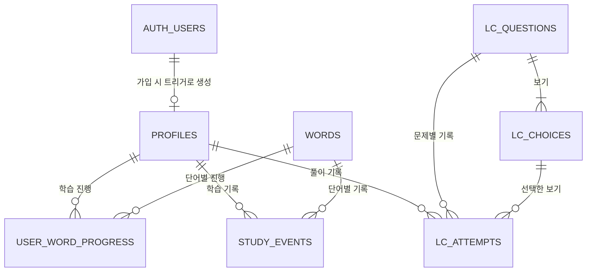

# PRD: 토익 단어 · LC 학습 웹서비스 (가칭)

> 상태: 초안 v0.8 (단어장 화면, 브라우저 음성 발음 듣기, 퀴즈 이어 풀기 추가)
> 개발 순서: **1단계 단어 학습(MVP)** → 2단계 LC(듣기) 추가 → 3단계 통계·점수 목표 관리
> 콘텐츠 원칙: 토익 공식·출판사 기출은 사용하지 않고, 개방 라이선스 단어 목록 + 직접 제작한 오리지널 콘텐츠만 사용한다.
> 목표 일정: 10/23(금) Demo Day까지 MVP 배포 완료

### v0.8 변경 요약

| 구분 | 변경 내용 |
|---|---|
| 화면 | 단어장 화면 추가(학습한 모든 단어의 검색·필터·정렬·뜻 가리기, 8.13). 하단 탭·상단 메뉴를 홈 / 단어장 / 오답노트 / 더보기 4개로 변경 (8.5, 12.3) |
| 기능 | 단어·예문 발음 듣기를 브라우저 내장 음성 합성(Web Speech API)으로 제공. 서버·비용 없음, 미지원 환경에서는 버튼을 숨긴다. 사전 생성 TTS 음성은 Later로 유지 (5, 8.7) |
| 퀴즈 | 홈에서 오늘 학습한 단어 전체로 확인 퀴즈를 열고, 풀다 나간 퀴즈는 같은 브라우저 세션에서 이어 푼다 (8.5, 8.8) |
| 홈 | 오늘 학습한 단어 목록을 10개씩 페이지로 보여준다. 오늘 학습한 단어는 현재 목표 점수로 학습한 단어만 센다 (8.5) |

### v0.7 변경 요약

| 구분 | 변경 내용 |
|---|---|
| 학습 규칙 | 퀴즈 정답에 따른 단계 상승(box, 다음 복습일, 연속 정답 수)은 단어마다 하루(KST) 한 번만 적용한다. 같은 날 다시 맞히면 정답 기록만 남긴다. 오답은 언제든 0단계로 초기화한다. 오답노트 해제(연속 2회 정답)도 서로 다른 날의 정답으로 센다 (FR-06, 11.3) |
| API | `record_quiz_answer` 반복 호출로 단계를 올릴 수 있던 알려진 제한을 해소 (11.5) |

### v0.6 변경 요약

| 구분 | 변경 내용 |
|---|---|
| 학습 규칙 | Day를 단어 묶음이 아닌 연속 학습일 카운터로 재정의. 하루에 Day는 하나이고 추가 학습으로 늘지 않으며, 하루를 건너뛰면 초기화되고, 목표 점수를 바꿔도 유지된다. Day 순서 진행과 Day 목록 화면(8.6)을 제거 |
| 학습 상한 | 하루 신규 학습 상한 40개(하루 목표 포함). 목표 점수를 바꾸면 새 목표로 다시 40개까지 학습 가능. 관리자는 무제한. 복습은 상한에서 제외 |
| 복습 | 처음 학습하고 "알아요"를 고른 단어의 다음 복습일을 +1일 또는 +2일로 번갈아 배정해 하루에 몰리지 않게 함 (FR-06) |
| 데이터 | `words.day_no`와 Day 관련 RPC(`get_day_summaries`) 삭제. `user_word_progress.target_score` 추가. `get_home_summary`에 `daily_cap`, `remaining_new` 추가 |

### v0.5 변경 요약

| 구분 | 변경 내용 |
|---|---|
| 학습 규칙 | FR-03 확정: 목표 점수는 시작 tier만 정하고, Day 순번대로 진행하다 tier를 끝내면 다음 tier로 이동. 단어 세트 분리 안은 채택하지 않음. 마지막 tier 이후 처리(낮은 구간 복귀, 전체 완료 안내) 명시 |
| 데이터 | 11.2에 tier 배정 기준(NGSL 1~1,000위=500, 이후=600, TSL 3등분=700/800/900), 시드 규칙(기능어 제외, 표제어당 1행, Day 20개, 데모 tier별 40개) 추가 |

### v0.4 변경 요약

| 구분 | 변경 내용 |
|---|---|
| 보안 | profiles 직접 수정 금지, `save_onboarding` RPC로만 저장(role 권한 상승 차단). RPC 공통 규칙(`search_path` 고정, anon 실행 권한 회수, 인자 검증) 추가 |
| 무결성 | CHECK·UNIQUE·NOT NULL 제약, FK 삭제 동작(사용자 cascade, 단어 restrict), 인덱스 명시. 재시드 시 단어 id 유지 |
| 스키마 | `user_word_progress`에 `first_studied_date`(생성 컬럼), `last_wrong_at` 추가. 기본키를 `(user_id, word_id)` 복합키로 변경하고 `id` 제거. `mastered`는 box 4에서만 가능하다는 CHECK 추가 |
| ERD | 11.7에 ERD 다이어그램, `Profiles`-`Words` M:N 관계 설명, LC 관계 보강. LC 보기의 정답 노출 방지 규칙 추가 |
| 학습 규칙 | 플래시카드는 첫 학습 시에만 box를 정한다. 퀴즈는 진행 정보가 있는 단어만 채점한다. 진행 정보 상태 전이 표 추가. 연속 학습일 계산 기준 명시 |
| API | `get_today_words` 개수를 서버가 계산(`p_extra`). `get_quiz_choices` 반환 형태, `get_home_summary`의 `studied_dates`, 직접 조회 목록, (P1) `get_day_summaries` 추가 |

### v0.3 변경 요약

| 구분 | 변경 내용 |
|---|---|
| 이용 정책 | 게스트 이용 및 게스트 기록 이전 제거. 모든 학습 기능은 로그인 후 이용 (게스트 체험은 v2 검토) |
| 범위 | Must Have를 P0(데모 필수) / P1(여유 시 구현)으로 구분. 데모용 단어 100~200개(5~10 Day)로 축소 |
| 학습 규칙 | "오늘의 학습" 구성 규칙, 목표 점수의 역할(시작 구간), "오늘 학습한 단어 수" 기준 정의 |
| 데이터 | `quiz_attempts` → `study_events`로 확장(플래시카드 응답 포함, 연속 학습일 계산용). `first_studied_at` 추가. 가입 시 프로필 자동 생성 트리거 명시 |
| 인증 | 소셜 로그인(카카오/구글)을 P1으로 추가. 데모 기간 이메일 인증 정책 명시 |
| 배포·운영 | 배포 및 운영(13.6), 이번 주 개발 일정(13.7), 배포 수용 기준(AC-10), Demo Day 시나리오 추가 |
| 레이아웃 | 데스크톱(1024px 이상)을 상단 메뉴 + 최대 1120px 콘텐츠 영역의 반응형 레이아웃으로 변경 (Figma 시안 기준, 12.3) |
| 디자인 | 포인트 컬러를 플럼으로, 단어·숫자 서체를 세리프로 변경. 홈의 연속 학습을 요일별 기록으로, Day 목록을 점수 구간 묶음 없는 번호순 목록으로 변경 (12.3, 12.4) |

## 1. Product Summary

토익 점수 향상을 목표로 하는 학습자가 **토익 빈출 단어를 매일 짧게 학습하고, 틀린 단어를 자동으로 복습**할 수 있는 모바일 친화형 웹서비스.

MVP에서는 단어 학습에 집중한다. 사용자는 회원가입 후 목표 점수와 하루 학습량을 정하고, 목표 점수에 맞는 구간부터 빈출 단어를 플래시카드로 학습한 뒤 4지선다 퀴즈로 확인한다. 모르는 단어와 틀린 단어는 간단한 간격 반복(SRS) 규칙에 따라 복습 일정에 자동 편성되고, 오답노트에 모인다.

**이용 정책:** 모든 학습 기능은 로그인 후 이용한다. 학습 기록이 처음부터 계정에 저장되므로 기기를 바꾸거나 브라우저 데이터를 지워도 기록이 유지된다. 가입 부담은 짧은 가입 양식과 소셜 로그인(P1)으로 줄인다.

이후 버전에서 토익 LC 형식(Part 1~4)의 오리지널 듣기 문제를 추가한다. 음성은 TTS로 미리 생성해 저장하고, 단어 학습에서 익힌 어휘가 LC 문제에서 다시 등장하도록 연결한다.

> 본 서비스는 ETS와 무관한 토익 대비용 학습 서비스이며, TOEIC은 ETS의 등록상표이다. (앱 내 면책 문구로 표시)

## 2. Target User

### Primary User: 토익 준비 학습자

- 취업·졸업 요건 등을 위해 토익 점수 향상이 필요한 대학생 및 취업 준비생
- 단어 암기가 막혀 있거나, 어떤 단어부터 외워야 할지 모르는 학습자
- 하루 10~20분 정도 짧게, 꾸준히 학습하고 싶은 학습자

### Secondary User: 직장인 학습자

- 승진·인사 평가 등을 위해 토익 점수가 필요한 직장인
- 출퇴근, 점심시간 등 틈새 시간에 모바일로 학습하고 싶은 사용자

### Admin: 콘텐츠 관리자

- 단어 데이터와 문제 콘텐츠를 검수하고 반영하는 운영자(초기에는 서비스 제작자 본인)
- MVP에서는 별도 관리자 화면 없이 Supabase 대시보드 및 시드 스크립트로 콘텐츠를 관리한다.

## 3. Problem

**1) 무엇부터 외워야 할지 모른다.**
일반 영어 단어장은 토익 출제 경향과 무관하게 구성되어 있어, 시험에 자주 나오는 단어를 우선해서 학습하기 어렵다.

**2) 외운 단어를 금방 잊고, 복습 관리가 안 된다.**
종이 단어장이나 단순 카드 앱은 어떤 단어를 언제 복습해야 하는지 알려주지 않아, 학습자가 직접 틀린 단어를 정리해야 한다.

**3) 단어 학습과 듣기(LC) 학습이 분리되어 있다.**
단어는 단어장으로, 듣기는 교재와 음원으로 따로 공부하다 보니 학습한 단어가 듣기에서 어떻게 들리는지 연결하기 어렵다.

**4) 기출 기반 서비스는 접근 부담이 크다.**
공식·출판사 기출 콘텐츠는 유료이거나 사용 범위가 제한되어, 가볍게 시작하기 어렵다.

**해결해야 하는 이유**
토익은 어휘력과 듣기 능력이 점수에 직접 영향을 주는 시험이다. 빈출 어휘를 우선 학습하고, 복습을 자동화하며, 이후 듣기까지 하나의 흐름으로 연결하면 학습 부담을 줄이고 꾸준함을 높일 수 있다.

## 4. Core Value

### 4.1 사용자 가치

**학습자**
- 목표 점수에 맞는 구간부터 토익 빈출 어휘를 학습할 수 있다.
- 하루 목표량만큼만 학습하면 되도록 학습 부담이 명확하다.
- 틀린 단어와 모르는 단어가 자동으로 복습에 편성되어 직접 관리할 필요가 없다.
- 오답노트로 약한 단어만 모아 다시 학습할 수 있다.
- 학습 기록이 계정에 저장되어 어느 기기에서든 이어서 학습할 수 있다.
- (2단계) 학습한 단어가 포함된 LC 문제를 풀며 단어와 듣기를 함께 연습할 수 있다.

### 4.2 차별점

| 차별점 | 내용 |
|---|---|
| 토익 특화 어휘 | 토익 빈출 어휘 목록 기반으로 학습 범위 구성 |
| 목표 점수별 시작점 | 목표 점수에 따라 학습 시작 구간을 자동으로 정함 |
| 자동 복습 | 단어별 복습 일정(SRS)과 오답노트를 기본 제공 |
| 단어 → LC 연결 | 학습한 단어가 LC 문제에서 재등장하도록 설계(2단계) |
| 짧은 세션 | 하루 10분 내외로 끝낼 수 있는 학습 단위 |
| 합법적인 오리지널 콘텐츠 | 기출 복제 없이 직접 제작·검수한 예문과 문제 사용 |

### 4.3 서비스 모델 및 수익 구조 (MVP 이후 검증)

MVP에서는 결제를 구현하지 않고 **전체 기능을 무료로 제공해 학습 흐름과 재방문율을 검증**한다. 수익 모델은 아래 방향으로 검토한다.

| 구분 | 내용 | 시기 |
|---|---|---|
| 무료(Free) | 단어 학습, 기본 퀴즈, 오답노트 | MVP |
| 프리미엄 구독 | 학습량 무제한, LC 전 파트, 상세 학습 통계, 광고 없음 | 2~3단계 이후 |
| 제휴/B2B(선택) | 학원·기관용 단체 계정, 학습 현황 리포트 | 서비스 안정화 이후 |

- 유료 전환 지점은 사용자가 학습 습관이 생긴 이후(예: LC 확장, 상세 통계)에 둔다.
- 구체적인 가격, 결제 수단은 MVP 사용자 반응을 확인한 뒤 결정한다.
- 콘텐츠를 직접 제작하므로 외부 기출 사용료가 발생하지 않는다.

## 5. MVP Scope

**우선순위 기준**
- **P0:** Demo Day(10/23) 시연에 반드시 필요한 기능. 미완성 시 배포하지 않는다.
- **P1:** P0 완료 후 여유가 있으면 구현. 미완성 시 Later로 이동한다.

### Must Have (1단계: 단어)

**계정 및 인증**
- [P0] 이메일·비밀번호 회원가입, 로그인, 로그아웃
- [P0] 비로그인 사용자는 랜딩·로그인·회원가입 페이지만 접근, 그 외 페이지는 로그인 페이지로 이동
- [P0] 가입 시 프로필 자동 생성
- [P1] 소셜 로그인(카카오 또는 구글 중 1개 이상, Supabase Auth Provider 사용)

**온보딩**
- [P0] 목표 점수 선택(500 이하 / 600 / 700 / 800 / 900+)
- [P0] 하루 학습 단어 수 선택(10 / 20 / 30개)
- [P0] 목표 점수에 따라 학습 시작 구간 결정(규칙: FR-03)
- [P1] 설정 변경(더보기 화면)

**단어 학습**
- [P0] 점수대(tier)별 단어 세트(데모 기준 tier당 80개, 총 400개). 하루 신규 학습 상한(40개) 기준으로 tier 하나가 이틀 분량이다. 이후 단어 수는 데모 이후 확충
- [P0] "오늘의 학습": 시작 구간부터 아직 학습하지 않은 단어를 하루 목표 수만큼 순서대로 제공(규칙: FR-05)
- [P0] 플래시카드 학습: 단어, 품사, 한국어 뜻, 예문(영문 + 한국어)
- [P0] 카드마다 "알아요 / 모르겠어요" 선택
- [P0] 하루 신규 학습 상한 40개(하루 목표 포함, 관리자는 무제한). 복습은 상한에서 제외(규칙: FR-05)
- [P1] 단어·예문 발음 듣기(브라우저 내장 음성 합성, v0.8)
- [P1] 단어장: 학습한 모든 단어의 검색·필터(전체 / 복습 필요 / 오답 / 익힘)·정렬(알파벳 / 최근 학습)·뜻 가리기(v0.8)

**퀴즈**
- [P0] 학습한 단어 대상 4지선다 퀴즈(영어 → 한국어 뜻)
- [P0] 보기는 같은 품사의 다른 단어 뜻으로 시스템이 구성
- [P0] 결과 화면에서 정답 수와 틀린 단어 확인

**복습 및 오답노트**
- [P0] 간단한 SRS: 단계별 복습 간격(당일 → 1일 → 3일 → 7일 → 14일)
- [P0] 오늘 복습할 단어 목록 및 복습 퀴즈
- [P0] 오답노트: 틀린 적 있는 단어 모아보기
- [P1] 오답 단어만 다시 학습(플래시카드·퀴즈)

**홈 / 학습 기록**
- [P0] 오늘의 학습 목표 진행률
- [P0] 오늘 복습 대기 단어 수
- [P1] 연속 학습일(streak)

**공통 기능**
- [P0] 입력값 유효성 검사
- [P0] 본인 데이터만 조회·수정 가능한 접근 제어(RLS)
- [P0] 모바일 우선 반응형 웹 UI
- [P0] 로딩, 오류, 빈 화면 처리
- [P0] TOEIC 상표 면책 문구(랜딩·더보기)
- [P1] 오픈소스·데이터 출처 표기 화면

### Later (추후 구현)

**v2: 진입 장벽 낮추기**
- 게스트 체험(로그인 없이 일부 구간 학습)
- 게스트 학습 기록의 계정 이전 및 병합

**2단계: LC(듣기)**
- Part 2(질의응답) 오리지널 문제 — 짧은 음성, 보기 3개
- Part 1(사진 묘사), Part 3(짧은 대화), Part 4(담화) 확장
- 억양별(미국·영국·호주 등) TTS 음성
- 문제별 대본·해설, 재생 속도 조절, 오답노트 연동

**3단계: 고도화**
- 단어 발음 듣기(사전 생성 TTS 음성, 기기와 무관한 일정한 음질. MVP는 브라우저 음성 합성)
- 학습 통계(주간 학습량, 정답률, 취약 품사)
- 목표 점수 기반 학습 플랜 추천
- 즐겨찾기(북마크), 학습 전 단어까지 포함한 검색 (학습한 단어 검색은 단어장에서 제공)
- 프로필 수정
- 프리미엄 구독 및 결제(토스페이먼츠 등)
- 복습 알림(알림톡·SMS 등)
- 관리자 콘텐츠 관리 화면
- Part 5·6 어휘/문법 문제

### Out of Scope (개발 대상에서 제외)

- 토익 공식·출판사 기출문제 및 음원 사용
- 실제 토익 점수 환산 및 공식 점수 예측
- 실시간 대결·랭킹, 친구 기능
- AI 튜터 및 AI 챗봇
- 모바일 네이티브 앱
- 외부 교육 플랫폼 연동

## 6. User Scenario

### Scenario 1. 첫 사용: 가입 및 첫 학습

1. 토익 700점이 목표인 대학생이 서비스에 접속한다.
2. 랜딩 페이지에서 "시작하기"를 눌러 이메일과 비밀번호로 회원가입한다.
3. 온보딩에서 목표 점수 700점, 하루 20단어를 선택한다. 학습 시작 구간이 600점 구간으로 정해진다.
4. 홈 화면에서 "오늘의 학습 시작"을 누른다.
5. 플래시카드로 단어 20개를 확인하며 "알아요 / 모르겠어요"를 선택한다.
6. 학습이 끝나면 4지선다 퀴즈로 바로 확인한다.
7. 결과 화면에서 정답 수와 틀린 단어를 확인하고 홈으로 돌아온다.
8. 홈에서 오늘 목표 달성(20 / 20)과 연속 학습 1일을 확인한다.

### Scenario 2. 복습 및 오답노트 활용

1. 다음 날 출퇴근 중인 직장인이 모바일로 접속한다. 로그인 상태가 유지되어 바로 홈으로 이동한다.
2. 홈에서 "오늘 복습할 단어 18개"를 확인한다.
3. 복습 퀴즈를 풀고, 맞힌 단어는 다음 복습 단계로 이동한다.
4. 틀린 단어는 복습 단계가 초기화되고 오답노트에 남는다.
5. 오답노트에서 틀린 단어만 모아 다시 학습한다.
6. 복습을 마치고 오늘의 새 단어 학습을 이어서 진행한다.

### Scenario 3. Demo Day 시연 (10/23)

**사전 준비:** 이틀 이상의 학습 기록(복습 대기 단어, 오답 단어, 연속 학습일)이 있는 데모 계정을 시드 스크립트로 만들어 둔다.

1. 배포 URL에 접속해 랜딩 페이지와 면책 문구를 보여준다.
2. 새 계정으로 가입 → 온보딩(목표 점수·하루 학습량) → 오늘의 학습 → 퀴즈 → 결과 화면까지 진행한다.
3. 데모 계정으로 로그인해 복습 대기 단어, 복습 퀴즈, 오답노트, 연속 학습일을 보여준다.
4. 모바일 화면(또는 개발자 도구의 모바일 보기)에서 같은 흐름이 동작함을 보여준다.
5. 다른 계정의 데이터에 접근할 수 없음(RLS)을 간단히 설명한다.

### Scenario 4. LC 문제 풀이 (2단계, Later)

1. 단어 학습이 어느 정도 진행된 학습자가 "LC 연습"을 선택한다.
2. Part 2 문제를 선택하면 음성이 재생된다.
3. 학습자가 보기 3개 중 정답을 선택한다.
4. 결과 화면에서 대본, 해설, 핵심 단어를 확인한다.
5. 틀린 문제와 모르는 단어가 오답노트에 함께 저장된다.

## 7. User Flow

### 7.1 인증 및 온보딩

**웹사이트 접속**
- 로그인 상태
  - 온보딩 완료 → 홈 화면
  - 온보딩 미완료 → 온보딩 화면
- 비로그인 상태
  - 랜딩 페이지
    - 시작하기 / 회원가입 선택 → 회원가입 페이지
    - 로그인 선택 → 로그인 페이지
  - 로그인이 필요한 페이지 URL로 직접 접근 → 로그인 페이지로 이동, 로그인 후 원래 페이지로 복귀

**회원가입**
1. 이름, 이메일, 비밀번호, 비밀번호 확인 입력
2. 회원가입 버튼 클릭
3. 입력값 유효성 검사
   - 유효함 → 계정 생성 및 프로필 자동 생성 → 온보딩 화면
   - 유효하지 않음 / 이미 가입된 이메일 → 오류 메시지 표시
   - 이메일 인증이 켜져 있는 경우 → 인증 안내 화면 → 메일의 링크로 인증 후 로그인

**소셜 로그인 (P1)**
1. 로그인 또는 회원가입 페이지에서 소셜 로그인 버튼 클릭
2. 제공자 인증 화면에서 동의
3. 서비스로 돌아오면
   - 신규 사용자 → 프로필 자동 생성 → 온보딩 화면
   - 기존 사용자 → 온보딩 완료 여부에 따라 홈 또는 온보딩
   - 인증 취소·실패 → 로그인 페이지에 오류 메시지

**온보딩**
1. 목표 점수 선택
2. 하루 학습 단어 수 선택
3. 시작하기 클릭 → 설정 저장, 시작 구간 결정 → 홈 화면
4. 미선택 시 안내 메시지 표시

### 7.2 단어 학습

**홈 화면**
- "오늘의 학습 시작" → 오늘의 학습 단어로 플래시카드 학습 화면
  - 오늘 목표를 이미 달성 → "오늘 목표 완료" 표시, 추가 학습 선택 가능(하루 상한 40개까지, 관리자는 제한 없음)
  - 하루 상한을 모두 채움 → "오늘은 여기까지 학습했어요" 안내
  - 학습할 새 단어가 남아 있지 않음 → "모든 단어를 학습했어요" 안내
- "오늘의 복습" → 복습 퀴즈 화면(복습 대기 단어가 0개면 안내 문구 표시)
- "오답노트" → 오답노트 화면

**플래시카드 학습**
1. 카드 앞면(단어, 품사) 표시
2. 카드를 눌러 뒷면(뜻, 예문) 확인
3. "알아요" 또는 "모르겠어요" 선택
   - 응답 즉시 서버에 저장 후 다음 카드
   - 저장 실패 → 오류 토스트, 같은 카드에서 재시도
4. 마지막 카드 완료 → 퀴즈 시작 안내
5. 중간에 나가기 → 확인창 표시 후 홈으로 이동(이미 응답한 카드는 저장되어 있음)

**퀴즈**
1. 단어 표시 + 보기 4개
2. 보기 선택 → 정답/오답 즉시 표시
   - 정답 → 해당 단어 복습 단계 상승
   - 오답 → 복습 단계 초기화, 오답노트에 반영
3. 다음 문제로 이동
4. 마지막 문제 완료 → 결과 화면(정답 수, 틀린 단어 목록)
5. 결과 화면에서 홈 또는 틀린 단어 다시 학습 선택

### 7.3 복습 및 오답노트

**복습**
1. 오늘 복습 예정인 단어 조회
2. 복습 퀴즈 진행(7.2 퀴즈와 동일 규칙)
3. 완료 후 결과 화면

**오답노트**
1. 틀린 적 있는 단어 목록 표시(최근 오답 순)
2. 단어 선택 → 뜻과 예문 확인
3. "오답 단어 다시 학습"(P1) → 오답 단어 대상 플래시카드·퀴즈 진행
4. 오답 없음 → 빈 화면 안내

## 8. Screens

| 화면 | 경로(예시) | 접근 권한 |
|---|---|---|
| 랜딩 | `/` | 모두 (로그인 시 홈 또는 온보딩으로 이동) |
| 회원가입 | `/signup` | 비로그인 |
| 로그인 | `/login` | 비로그인 |
| 온보딩 | `/onboarding` | 로그인 |
| 홈 | `/home` | 로그인 + 온보딩 완료 |
| 플래시카드 학습 | `/learn` | 로그인 + 온보딩 완료 |
| 퀴즈 / 결과 | `/quiz`, `/quiz/result` | 로그인 + 온보딩 완료 |
| 복습 | `/review` | 로그인 + 온보딩 완료 |
| 오답노트 | `/wrong-notes` | 로그인 + 온보딩 완료 |
| 더보기 / 라이선스 | `/more`, `/licenses` | 로그인 |

### 8.1 랜딩 페이지

**목적:** 서비스 소개 및 가입·로그인 유도

**구성 요소**
- 서비스 로고 및 이름
- 서비스 소개 문구(토익 빈출 단어 + 자동 복습)
- 시작하기(회원가입) 버튼, 로그인 버튼
- (P1) 소셜 로그인 버튼
- 하단 면책 문구(TOEIC은 ETS의 등록상표이며 본 서비스는 ETS와 무관)

**동작**
- 시작하기 → 회원가입 페이지
- 이미 로그인한 사용자 → 온보딩 상태에 따라 홈 또는 온보딩으로 이동

### 8.2 회원가입 페이지

**구성 요소:** 이름, 이메일, 비밀번호, 비밀번호 확인 입력란 / 회원가입 버튼 / (P1) 소셜 로그인 버튼 / 로그인 이동 링크 / 오류 메시지 영역

**동작:** 필수 항목, 이메일 형식, 비밀번호 길이, 비밀번호 일치, 중복 이메일 검증 후 성공 시 온보딩으로 이동

### 8.3 로그인 페이지

**구성 요소:** 이메일, 비밀번호 입력란 / 로그인 버튼 / (P1) 소셜 로그인 버튼 / 회원가입 이동 링크 / 오류 메시지 영역

**동작:** 인증 성공 → 원래 접근하려던 페이지가 있으면 그 페이지로, 없으면 온보딩 완료 여부에 따라 홈 또는 온보딩. 실패 → 오류 메시지

### 8.4 온보딩 페이지

**목적:** 목표 점수와 하루 학습량 설정

**구성 요소**
- 목표 점수 선택(500 이하 / 600 / 700 / 800 / 900+ 막대 선택)
- 선택한 목표 점수 안내(예: "700점 목표에 맞는 단어로 시작해요")
- 하루 학습 단어 수 선택(10 / 20 / 30 카드. 각각 "가볍게 시작" / "적당한 분량" / "집중 학습" 설명 표시)
- 시작하기 버튼

**동작:** 두 항목 모두 선택해야 시작 가능, 서버에 저장 후 홈으로 이동

### 8.5 홈 화면

**목적:** 오늘의 학습 현황 확인 및 학습 진입

**구성 요소**
- 인사 문구, 목표 점수 표시
- 오늘 학습 진행률(예: 12 / 20)
- 연속 학습일("Day N")과 이번 주(월~일) 요일별 학습 기록(P1)
- 오늘의 학습 시작 / 이어서 학습 버튼
- 오늘 학습한 단어 목록(10개씩 페이지 이동). 현재 목표 점수로 오늘 처음 학습한 단어만 표시
- 오늘 학습한 단어 확인 퀴즈 버튼. 풀다 나간 퀴즈가 있으면 "퀴즈 이어서 N/M"으로 표시
- 오늘 복습 대기 단어 수 및 복습 시작 버튼
- 오답노트 바로가기
- 하단 탭(홈 / 단어장 / 오답노트 / 더보기)
- 요약 조회 실패 시 오류 안내와 다시 시도 버튼, 로딩 중 스켈레톤

**동작**
- 학습 시작 → 플래시카드 학습 화면
- 복습 시작 → 복습 퀴즈 화면
- 복습 대기 0개 → "오늘 복습할 단어가 없어요" 표시
- 오늘 목표 달성 → "오늘 목표 완료" 격려 문구와 추가 학습 버튼
- 하루 상한(40개)에 도달 → 추가 학습 버튼을 숨기고 "오늘은 여기까지 학습했어요" 안내(관리자는 제한 없음)
- 복습 단어 카드에는 "N일 전 학습" 배지를 표시할 수 있다(`first_studied_date`로 계산)

### 8.6 Day 목록 화면 (삭제)

**삭제(v0.6):** Day는 연속 학습일 카운터이므로 단어 묶음을 고르는 Day 목록 화면은 두지 않는다. 학습 이력 확인이 필요하면 별도 기능으로 검토한다.

### 8.7 플래시카드 학습 화면

**구성 요소**
- 진행도 표시(예: 5 / 20), 나가기 버튼
- 카드 앞면: 영어 단어, 품사
- 카드 뒷면: 한국어 뜻, 영문 예문, 예문 해석
- "알아요" / "모르겠어요" 버튼
- 단어·예문 발음 듣기 버튼(v0.8). 브라우저 내장 음성 합성(Web Speech API, 미국 영어)을 쓰며, 지원하지 않는 브라우저에서는 버튼을 숨긴다

**동작**
- 카드 터치(또는 Space 키)로 앞·뒷면 전환
- 선택 시 서버 저장 후 다음 카드로 이동, 마지막 카드 후 퀴즈 안내
- 저장 중 버튼 비활성화

### 8.8 퀴즈 화면

**구성 요소:** 진행도, 단어, 4지선다 보기, 정답/오답 표시, 다음 버튼

**동작:** 보기 선택 시 즉시 채점 및 정답 표시 → 다음 문제 → 마지막 후 결과 화면 이동. 제출 중 중복 선택 방지

**이어 풀기(v0.8):** 푼 문제의 결과를 브라우저 세션(`sessionStorage`)에 저장한다. 퀴즈를 나갔다가 같은 모드·같은 단어 목록으로 다시 들어오면 푼 문제 다음부터 이어 푼다. 다 푼 퀴즈는 이어 풀기 대상이 아니다. 브라우저 탭을 닫으면 기록이 사라진다.

### 8.9 퀴즈 결과 화면

**구성 요소:** 정답 수/전체 수, 틀린 단어 목록(뜻 포함), 틀린 단어 다시 학습 버튼, 홈으로 버튼

### 8.10 복습 화면

**목적:** 오늘 복습 예정 단어 퀴즈 진행

**구성 요소:** 퀴즈 화면과 동일 구성 + 오늘 복습 단어 수 표시

### 8.11 오답노트 화면

**구성 요소:** 틀린 단어 목록(단어, 뜻, 오답 횟수), 오답 단어 다시 학습 버튼(P1), 빈 화면 안내

### 8.12 더보기 화면

**구성 요소**
- 목표 점수·하루 학습량 변경(P1)
- 로그아웃 버튼
- 오픈소스 및 데이터 출처 표기(라이선스) 화면 이동(P1)
- 면책 문구(TOEIC은 ETS의 등록상표이며 본 서비스는 ETS와 무관)

### 8.13 단어장 화면 (v0.8)

**목적:** 지금까지 학습한 단어를 다시 찾아보고 훑어보기

**구성 요소**
- 검색(영어 단어·뜻)
- 필터: 전체 / 복습 필요(`next_review_at <= 오늘`) / 오답(오답노트와 같은 기준) / 익힘(`mastered`)
- 정렬: 알파벳(첫 글자별 묶음) / 최근 학습(학습 날짜별 묶음)
- 뜻 가리기 스위치
- 단어 행: 단어, 품사, 뜻, 발음 듣기. 펼치면 예문과 예문 해석, 예문 발음 듣기

**동작**
- 목표 점수와 무관하게 학습 진행 정보가 있는 모든 단어를 한 번에 불러오고, 검색·필터·정렬은 화면에서 처리한다
- 목록은 60개씩 그리고 스크롤이 끝에 닿으면 더 그린다
- 학습한 단어가 없으면 빈 화면 안내와 학습 시작 버튼, 조회 실패 시 오류 안내와 다시 시도 버튼

## 9. Functional Requirements

### FR-01. 회원가입 및 인증

- 사용자는 이름, 이메일, 비밀번호로 회원가입할 수 있어야 한다. 비밀번호는 8자 이상으로 한다.
- 이메일은 중복 가입이 불가능해야 한다.
- 비밀번호는 Supabase Auth가 관리하며 애플리케이션 DB에 저장하지 않는다.
- 가입 시 `auth.users` 생성 트리거(`handle_new_user`)로 `profiles` 행을 자동 생성하고, 가입 시 입력한 이름(user metadata)을 `name`에 저장한다. 소셜 로그인 사용자는 제공자의 이름을 사용하고, 없으면 이메일 앞부분을 사용한다.
- 로그인 성공 시 세션이 유지되고, 로그아웃 시 세션이 종료되어야 한다.
- (P1) 카카오 또는 구글 소셜 로그인을 Supabase Auth Provider로 제공한다. 같은 이메일의 이메일 계정과 소셜 계정 연결은 MVP에서 다루지 않는다.

### FR-02. 사용자 권한 및 데이터 접근

- 사용자 역할은 `user`와 `admin`으로 구분하며, 가입 시 기본 역할은 `user`이다.
- 학습 진행 데이터, 학습 이벤트 기록은 본인만 조회할 수 있어야 한다.
- 단어 콘텐츠는 로그인한 사용자만 조회할 수 있으며, 일반 사용자는 수정할 수 없어야 한다.
- 권한 검증은 UI뿐 아니라 데이터베이스(RLS) 단계에서도 적용해야 한다.

### FR-03. 온보딩 및 학습 설정

- 최초 로그인 시 목표 점수와 하루 학습 단어 수를 필수로 설정해야 한다.
- 목표 점수는 **학습 시작 구간**을 결정한다. 목표 점수 바로 아래 구간부터 시작해 기초를 다진 뒤 목표 구간으로 올라간다.

  | 목표 점수 | 시작 구간(tier) |
  |---|---|
  | 500 이하 | 500 |
  | 600 | 500 |
  | 700 | 600 |
  | 800 | 700 |
  | 900+ | 800 |

- 시작 구간 매핑은 설정 가능한 상수로 관리한다.

- **확정(v0.5, v0.6 보완):** 목표 점수는 시작 tier만 정한다. 단어는 시작 tier부터 `freq_rank` 순으로 학습하고, tier의 단어를 모두 학습하면 다음 tier로 넘어간다. 목표 점수별로 단어 세트를 따로 두지 않는다.
- **Day(v0.6):** Day는 연속 학습일을 세는 카운터이며 단어 묶음이 아니다. 하루에 Day는 하나이고, 추가 학습을 해도 늘지 않는다. 하루를 건너뛰면 초기화된다. 목표 점수를 바꿔도 연속 학습일은 유지된다.
- (P1) 설정값은 더보기 화면에서 변경할 수 있어야 하며, 목표 점수를 바꾸면 이후 "오늘의 학습"의 시작 구간도 바뀐다. 기존 학습 기록과 연속 학습일은 유지되고, 새 목표 점수로 하루 신규 학습 상한(FR-05)을 다시 채울 수 있다.
- 온보딩을 완료하지 않은 사용자는 홈 화면 진입 시 온보딩으로 이동해야 한다.

### FR-04. 홈 대시보드

- **오늘 학습한 단어 수**는 오늘(KST) 현재 목표 점수로 처음 학습한 새 단어 수(`first_studied_date`가 오늘이고 `target_score`가 현재 목표 점수인 단어 수)로 계산하며, 하루 목표 대비 진행률로 표시한다. 복습한 단어는 포함하지 않는다.
- 오늘 복습 대기 단어 수를 표시해야 한다.
- (P1) 연속 학습일("Day N")을 표시해야 한다. `study_events`에 하루 1건 이상의 기록(플래시카드 응답 또는 퀴즈 응답)이 있으면 학습한 날로 계산한다. 오늘 기록이 아직 없으면 어제부터 거슬러 세어, 오늘 학습 전에 연속 기록이 0으로 보이지 않게 한다.
- 하루 기준은 한국 시간(KST, Asia/Seoul)을 따른다.

### FR-05. 단어 학습(플래시카드)

- 단어는 점수대(tier)별로 제공되어야 한다.
- **오늘의 학습 구성 규칙:** 시작 구간부터 `tier → freq_rank` 순서로 정렬했을 때, 아직 학습 기록이 없는 단어를 (하루 목표 − 오늘 학습한 단어 수)개만큼 가져온다. 시작 구간의 단어를 모두 학습하면 다음 구간으로 넘어간다. 900 구간까지 끝나면 시작 구간보다 낮은 구간(500부터)으로 돌아가고, 모든 단어를 학습했으면 "모든 단어를 학습했어요"를 표시한다.
- **하루 신규 학습 상한(v0.6):** 새 단어는 하루에 40개까지 학습할 수 있다(하루 목표 포함). 오늘 목표를 달성한 뒤에도 사용자가 원하면 상한 안에서 추가 학습을 할 수 있고, 추가 학습으로 연속 학습일(Day)이 늘지는 않는다.
  - 상한은 현재 목표 점수 기준으로 센다. 목표 점수를 바꾸면 새 목표 점수로 다시 40개까지 학습할 수 있다. 되돌려도 이미 센 개수는 초기화되지 않는다.
  - 관리자(`role = 'admin'`)는 상한 없이 학습할 수 있다. 이후 구독·결제 권한으로 대체할 수 있도록 판정을 서버 함수 한 곳에 둔다.
  - 복습은 상한에 포함하지 않는다.
  - 상한은 서버가 `record_flashcard`에서도 검사한다. 상한을 넘는 새 단어 학습 요청은 거부한다.
- 각 카드에는 단어, 품사, 한국어 뜻, 예문, 예문 해석이 표시되어야 한다.
- "알아요 / 모르겠어요" 선택은 즉시 서버 함수(`record_flashcard`)로 저장한다.
  - 처음 학습하는 단어는 `first_studied_at`을 기록한다.
  - 알아요 → 상태 `learning`, 복습 1단계, 다음 복습일 +1일 또는 +2일(FR-06의 복습일 분산)
  - 모르겠어요 → 상태 `learning`, 복습 0단계, 다음 복습일 당일
  - 응답은 `study_events`에 기록한다.
  - 이미 진행 정보가 있는 단어(복습·오답노트·반복 학습)는 복습 단계와 다음 복습일을 바꾸지 않고 응답 기록만 남긴다. 복습 단계는 퀴즈로만 바뀐다(FR-06).
- 학습 도중 나가더라도 이미 응답한 카드의 기록은 유지되어야 한다.

### FR-06. 복습 주기(SRS)

- 단어별 복습 단계(box)는 0~4로 관리한다.
- 단계별 복습 간격은 0단계 당일, 1단계 1일, 2단계 3일, 3단계 7일, 4단계 14일로 한다.
- 퀴즈에서 정답이면 단계를 1 올리고(최대 4), 오답이면 0단계로 초기화한다. 다음 복습일은 갱신된 단계의 간격으로 다시 계산한다.
- **하루 한 번 단계 상승(v0.7):** 정답에 따른 단계 상승은 단어마다 하루(KST) 한 번만 적용한다. 같은 날 같은 단어를 다시 맞히면(확인 퀴즈 반복, 복습·오답 퀴즈 중복 등) 단계, 다음 복습일, 연속 정답 수는 바뀌지 않고 정답 기록만 남는다. 오답은 횟수와 관계없이 즉시 0단계로 초기화하며, 같은 날 오답 뒤의 정답도 단계를 올리지 않는다. 그 결과 오답노트 해제(연속 2회 정답)도 서로 다른 날 맞혀야 한다.
- 4단계에서 정답 시 상태를 `mastered`로 바꾸고 이후에도 14일 간격으로 복습 대상에 포함한다. `mastered` 단어를 틀리면 `learning`으로 돌아간다.
- 오늘 복습 대상은 `next_review_at`이 오늘(KST) 이전이거나 같은 단어이다.
- **복습일 분산(v0.6):** 처음 학습하고 "알아요"를 고른 단어의 다음 복습일은 +1일과 +2일을 번갈아 배정한다(그날 처음 학습한 순서의 짝수·홀수). 전날 학습한 단어가 다음 날 한꺼번에 나오지 않게 하기 위해서다. 이후 단계의 복습일은 간격표를 그대로 따른다. 복습 대상은 기한이 된 단어 전부이며 개수 제한은 두지 않는다.
- 복습 간격 값은 코드에 하드코딩하지 않고 설정 가능한 상수로 관리한다.
- 복습 단계 갱신은 서버 함수(`record_quiz_answer`)에서만 수행한다. 단, 처음 학습하는 단어의 초기 단계는 `record_flashcard`가 정한다(FR-05).

### FR-07. 퀴즈

- 퀴즈는 영어 단어를 보고 한국어 뜻을 고르는 4지선다로 구성한다.
- 퀴즈 대상은 학습 진행 정보가 있는(플래시카드로 한 번 이상 학습한) 단어로 한정한다.
- 보기는 서버 함수(`get_quiz_choices`)로 생성한다. 오답 보기는 같은 품사의 다른 단어 뜻에서 무작위로 선택하며, 정답과 뜻이 중복되지 않아야 한다. 같은 품사 단어가 부족하면 다른 품사 단어로 채운다.
- 보기 순서는 매번 무작위로 섞는다.
- 정답/오답은 선택 즉시 표시하고, 응답 결과는 `study_events`에 저장한다.
- 퀴즈 결과 화면에서 정답 수와 틀린 단어를 확인할 수 있어야 한다.
- 제출 중에는 보기 중복 선택을 방지해야 한다.

### FR-08. 오답노트

- 한 번이라도 틀린 단어는 오답노트에 표시한다.
- 오답노트에는 단어, 뜻, 누적 오답 횟수가 표시되어야 한다.
- (P1) 오답 단어만 대상으로 플래시카드·퀴즈를 다시 진행할 수 있어야 한다.
- 오답노트에서 단어를 제거하려면 해당 단어를 퀴즈에서 연속 2회 맞혀야 한다.
- 오답이 없으면 빈 화면 안내를 표시한다.

### FR-09. 콘텐츠 출처 및 면책 표시

- 랜딩 페이지와 더보기 화면에 TOEIC 상표 면책 문구를 표시해야 한다.
- (P1) 더보기 화면에서 이동하는 라이선스 화면에 사용한 데이터 출처, 라이선스, 저작자 표기를 제공해야 한다.
- 서비스명, 로고, 화면 문구에 공식 토익 서비스로 오인될 수 있는 표현을 사용하지 않는다.

### FR-10. 페이지 이동 및 접근 제어

- 비로그인 사용자가 로그인이 필요한 페이지에 접근하면 로그인 페이지로 이동하고, 로그인 후 원래 페이지로 돌아와야 한다.
- 로그인한 사용자가 로그인·회원가입 페이지에 접근하면 홈으로 이동한다.
- 존재하지 않는 페이지에 접근하면 안내 화면(404)을 표시해야 한다.
- 배포 환경에서 어떤 경로든 새로고침해도 페이지가 정상 표시되고, 로그인 상태와 학습 진행 상태가 유지되어야 한다.

### FR-11. 오류 및 상태 처리

- 데이터 요청 중 로딩 상태를 표시해야 한다.
- 서버·네트워크 오류 발생 시 안내 메시지와 재시도 방법을 표시해야 한다.
- 저장 실패 시 사용자에게 알리고 진행 중인 학습 상태가 손상되지 않아야 한다.
- 복습 대상이나 오답이 없는 경우 빈 화면 안내를 표시해야 한다.
- 세션이 만료되면 로그인 페이지로 이동하고 안내 메시지를 표시한다.

## 10. Acceptance Criteria

다음 조건 중 P0 항목을 모두 충족하면 MVP(1단계) 배포가 가능한 것으로 판단한다. P1 항목은 해당 기능을 구현한 경우에만 확인한다.

### AC-01. 인증

- [ ] 회원가입이 정상적으로 동작하고, 가입 시 프로필이 자동 생성된다.
- [ ] 유효한 계정으로 로그인할 수 있다.
- [ ] 잘못된 로그인 정보 입력 시 오류 메시지가 표시된다.
- [ ] 로그아웃 시 세션이 종료된다.
- [ ] 이미 가입된 이메일로 가입할 수 없다.
- [ ] 일반 회원가입으로 관리자 권한을 얻을 수 없다.
- [ ] (P1) 소셜 로그인으로 가입·로그인할 수 있고, 신규 사용자는 온보딩으로 이동한다.

### AC-02. 온보딩

- [ ] 최초 로그인 시 온보딩 화면으로 이동한다.
- [ ] 목표 점수와 하루 학습량을 선택하지 않으면 시작할 수 없다.
- [ ] 목표 점수에 따라 시작 구간이 FR-03 규칙대로 정해진다.
- [ ] (P1) 더보기 화면에서 설정을 변경하면 홈 화면과 오늘의 학습에 반영된다.

### AC-03. 단어 학습

- [ ] 오늘의 학습이 시작 구간의 미학습 단어로 하루 목표 수만큼 구성된다.
- [ ] 카드 앞면·뒷면 전환이 정상 동작한다.
- [ ] "알아요 / 모르겠어요" 선택 결과가 저장되고 규칙대로 복습일이 정해진다.
- [ ] 학습 도중 나갔다가 돌아와도 응답한 카드 기록이 유지되고, 남은 단어부터 이어서 학습한다.
- [ ] 하루 신규 학습이 40개를 넘지 않고, 목표 점수를 바꾸면 새 목표로 다시 40개까지 학습할 수 있다. 관리자 계정은 제한 없이 학습할 수 있다.
- [ ] 추가 학습을 해도 연속 학습일(Day)이 늘지 않고, 목표 점수를 바꿔도 연속 학습일이 유지된다.
- [ ] "알아요"를 고른 단어의 다음 복습일이 +1일과 +2일로 나뉜다.

### AC-04. 퀴즈

- [ ] 4지선다 보기가 정답 1개와 오답 3개로 구성되고, 오답은 가능한 한 같은 품사에서 선택된다.
- [ ] 보기 중 중복되는 뜻이 없다.
- [ ] 선택 즉시 정답/오답이 표시된다.
- [ ] 빠르게 여러 번 눌러도 응답이 한 번만 기록된다.
- [ ] 퀴즈 결과 화면에 정답 수와 틀린 단어가 표시된다.
- [ ] 퀴즈 결과가 복습 단계에 반영된다.

### AC-05. 복습 및 오답노트

- [ ] 정답 시 복습 단계가 오르고 다음 복습일이 규칙대로 설정된다.
- [ ] 오답 시 복습 단계가 0으로 초기화된다.
- [ ] 복습일이 도래한 단어만 "오늘의 복습"에 표시된다.
- [ ] 틀린 단어가 오답노트에 표시된다.
- [ ] 연속 2회 정답(서로 다른 날) 시 오답노트에서 제외된다.
- [ ] 같은 날 같은 단어를 다시 맞혀도 복습 단계가 한 번만 오른다.
- [ ] (P1) 오답 단어만 다시 학습할 수 있다.

### AC-06. 홈 / 학습 기록

- [ ] 오늘 학습 진행률이 오늘 처음 학습한 새 단어 기준으로 정확히 표시된다.
- [ ] 오늘 복습 대기 단어 수가 정확히 표시된다.
- [ ] 자정(KST)이 지나면 오늘 진행률이 0으로 초기화된다.
- [ ] (P1) 연속 학습일이 플래시카드·퀴즈 기록 기준, 하루 단위(KST)로 정확히 계산된다.

- [ ] 홈의 확인 퀴즈를 풀다 나갔다가 다시 들어오면 푼 문제 다음부터 이어 푼다. (v0.8)
- [ ] (P1) 단어장에서 학습한 모든 단어를 검색·필터·정렬할 수 있고, 학습 전 단어는 보이지 않는다. (v0.8)
- [ ] (P1) 플래시카드와 단어장에서 단어·예문 발음을 들을 수 있고, 미지원 브라우저에서는 발음 버튼이 숨겨진다. (v0.8)

### AC-07. 접근 권한

- [ ] 비로그인 상태에서 로그인이 필요한 페이지 URL로 직접 접근하면 로그인 페이지로 이동한다.
- [ ] 비로그인 상태에서 API로 단어 데이터를 조회할 수 없다.
- [ ] 다른 사용자의 학습 기록, 오답 기록을 조회하거나 수정할 수 없다.
- [ ] API 요청을 직접 조작해도 복습 단계를 임의 값으로 바꿀 수 없다.
- [ ] 일반 사용자는 단어 콘텐츠를 수정할 수 없다.

### AC-08. 콘텐츠 및 표기

- [ ] 랜딩 페이지와 더보기 화면에 TOEIC 상표 면책 문구가 표시된다.
- [ ] 서비스 내에 공식·출판사 기출 문제나 음원이 포함되어 있지 않다.
- [ ] (P1) 더보기 화면에서 데이터 출처와 라이선스 표기를 확인할 수 있다.

### AC-09. UI/UX

- [ ] 모바일 화면(세로, 375px 기준)에서 모든 핵심 기능을 사용할 수 있다.
- [ ] 데스크톱 화면에서도 정상적으로 표시된다.
- [ ] 화면 너비 320px ~ 1920px에서 가로 스크롤 없이 표시된다.
- [ ] 로딩 상태, 오류 메시지, 빈 화면이 정상적으로 표시된다.
- [ ] 가입부터 첫 학습·퀴즈 완료까지 핵심 시나리오가 정상 동작한다.

### AC-10. 배포 및 운영

- [ ] HTTPS 배포 URL에서 서비스에 접속할 수 있다.
- [ ] 배포 환경에서 어떤 경로든 새로고침해도 404가 나지 않는다.
- [ ] 배포 환경에서 회원가입·로그인이 동작하고, 인증 관련 링크(이메일 인증, 소셜 로그인 복귀)가 localhost가 아닌 배포 도메인으로 연결된다.
- [ ] 저장소와 브라우저 번들에 Supabase service role 키가 포함되어 있지 않다.
- [ ] `main` 브랜치에 병합하면 자동으로 배포된다.
- [ ] PR에서 타입 검사와 빌드가 자동 실행되고, 실패 시 병합 전에 확인할 수 있다.
- [ ] 데이터베이스 스키마·RLS·서버 함수가 마이그레이션 파일로 저장소에 포함되어 있다.
- [ ] Demo Day용 데모 계정에 복습 대기 단어, 오답 단어, 연속 학습 기록이 준비되어 있다.

## 11. Data Requirements

데이터는 Supabase PostgreSQL에 저장하며, 사용자 인증은 Supabase Auth를 사용한다. 스키마, RLS, 서버 함수는 `supabase/migrations`의 마이그레이션 파일로 관리한다.

**공통 규칙**
- 아래 표의 모든 컬럼은 따로 적지 않으면 `NOT NULL`이다. NULL을 허용하는 컬럼은 설명에 표시한다.
- 허용 값이 정해진 컬럼(역할, 상태, 점수, 모드 등)은 CHECK 제약으로 DB에서 강제한다.
- 날짜(DATE) 컬럼은 서버에서 `(now() at time zone 'Asia/Seoul')::date`로 계산한다. 클라이언트가 보낸 날짜를 저장하지 않는다.
- 학습 규칙 값(복습 간격, 시작 구간 매핑, 오답노트 해제 기준)은 서버 SQL이 기준이다. `src/lib/constants.ts`는 화면 표시용으로 같은 값을 유지한다.

### 11.1 Profiles (사용자 프로필)

| 필드명 | 타입 | 설명 |
|---|---|---|
| id | UUID (PK) | Supabase Auth 사용자 ID |
| name | TEXT | 사용자 이름 |
| role | TEXT | user / admin (기본값 user) |
| target_score | INTEGER | 목표 점수 (온보딩 전 NULL) |
| start_tier | INTEGER | 학습 시작 구간 (서버가 목표 점수로 계산, 온보딩 전 NULL) |
| daily_goal | INTEGER | 하루 학습 단어 수 (10/20/30, 온보딩 전 NULL) |
| onboarded_at | TIMESTAMPTZ | 온보딩 완료 시각 (온보딩 전 NULL) |
| created_at | TIMESTAMPTZ | 계정 생성일 (기본값 `now()`) |

**규칙**
- `id`는 `auth.users.id`를 참조하며(`on delete cascade`), 가입 시 트리거(`handle_new_user`)로 자동 생성한다.
- 트리거는 `name`을 user metadata의 이름 → 소셜 제공자 이름 → 이메일 앞부분 순서로 채운다(`coalesce`). 트리거가 실패하면 가입 자체가 실패하므로, 값이 비어도 예외가 나지 않게 하고 `on conflict (id) do nothing`을 둔다.
- 이메일과 비밀번호는 Supabase Auth에서 관리한다.
- 본인 프로필만 조회할 수 있다.
- **클라이언트는 profiles를 직접 수정하지 않는다.** RLS update 정책만으로는 컬럼 단위 제한이 되지 않아 `role`을 바꿀 수 있기 때문이다. 테이블의 insert·update·delete 권한을 `authenticated`, `anon`에서 회수하고, 온보딩·설정 변경은 `save_onboarding` RPC로만 한다.
- `start_tier`와 `onboarded_at`은 `save_onboarding`이 서버에서 계산해 저장한다. 클라이언트가 보낸 시작 구간은 받지 않는다.
- CHECK 제약: `role in ('user', 'admin')`, `daily_goal in (10, 20, 30)`, `target_score`·`start_tier in (500, 600, 700, 800, 900)`.
- `admin` 역할 부여는 SQL(service role)로만 한다. MVP에는 관리자 화면이 없으므로 `role`을 참조하는 RLS 정책을 두지 않는다. 다만 `get_today_words`, `record_flashcard`, `get_home_summary`가 하루 신규 학습 상한(FR-05) 예외를 판정할 때만 `role = 'admin'`을 참조한다.

### 11.2 Words (단어)

| 필드명 | 타입 | 설명 |
|---|---|---|
| id | UUID (PK) | 단어 ID |
| headword | TEXT | 영어 단어(표제어) |
| pos | TEXT | 품사 (noun / verb / adj / adv 등) |
| meaning_ko | TEXT | 한국어 뜻 (직접 작성·검수) |
| example_en | TEXT | 영문 예문 (오리지널) |
| example_ko | TEXT | 예문 해석 |
| tier | INTEGER | 점수대 구분 (500 / 600 / 700 / 800 / 900, 500은 500점 이하 기초 구간) |
| freq_rank | INTEGER | 빈출 순위 (출처 목록 기준) |
| source | TEXT | 단어 목록 출처 |
| created_at | TIMESTAMPTZ | 등록일 (기본값 `now()`) |

**규칙**
- 같은 단어와 품사 조합은 중복 등록할 수 없다: `unique (headword, pos)`. `headword`는 앞뒤 공백을 제거하고 소문자로 저장한다.
- CHECK 제약: `tier in (500, 600, 700, 800, 900)`, `freq_rank > 0`.
- 단어의 학습 순서는 `tier`, `freq_rank`로만 정한다(Day 번호는 단어에 저장하지 않는다. 연속 학습일은 `study_events`로 계산한다).
- 뜻과 예문은 직접 작성하거나 AI로 초안을 만든 뒤 사람이 검수한 내용만 반영한다.
- 로그인한 사용자(`authenticated`)만 읽을 수 있다. insert·update·delete 권한은 `authenticated`, `anon`에서 회수하고, 쓰기는 service role을 쓰는 시드 스크립트로만 한다.
- **재시드 시 단어 id를 유지한다.** 시드 스크립트는 `on conflict (headword, pos) do update`로 내용만 갱신한다. id가 바뀌면 사용자 학습 기록과의 연결이 끊긴다.
- 학습 기록이 있는 단어는 삭제할 수 없다(진행 정보·이벤트의 FK가 `on delete restrict`).
- 인덱스: `(tier, freq_rank)` (오늘의 학습 정렬), `(pos)` (퀴즈 오답 보기 추출).
- 데모 기준 각 tier에 80개를 적재해 모든 목표 점수에서 학습을 시작할 수 있게 한다. 하루 상한 40개로 학습해도 다음 날 같은 tier의 새 단어가 남도록 tier당 하루 상한의 2배 이상으로 둔다.

**tier 배정과 시드 규칙 (v0.5 확정)**

| tier | 배정 기준 |
|---|---|
| 500 | NGSL 빈도 순위 1~1,000위 |
| 600 | NGSL 빈도 순위 1,001위 ~ 끝 |
| 700 / 800 / 900 | TSL 빈도 순위를 3등분 (높은 순위부터 700, 800, 900) |

- NGSL과 TSL에 모두 있는 단어는 NGSL 기준으로 배정한다.
- 경계값(1,000위, TSL 3등분 기준)은 시드 스크립트의 설정 상수로 두고, 조정 후 다시 시드한다. 재시드는 단어 id를 유지한다.
- 원본 파일(`seed/raw/`)은 DB에 넣지 않는다. 검수를 마친 CSV만 적재한다. `freq_rank`는 해당 `source` 목록 안의 순위다.
- 표제어 1개당 1행으로 둔다(대표 품사 1개). 품사는 원본에 없으므로 검수 단계에서 채운다.
- 관사·대명사·전치사·접속사·조동사 같은 기능어는 학습 대상에서 제외한다.
- 데모는 tier별 기능어와 모호한 단어를 뺀 빈도 상위 80개를 사용한다. (하루 신규 학습 상한 40개와는 별개의 값이다.)

### 11.3 User Word Progress (단어별 학습 진행)

| 필드명 | 타입 | 설명 |
|---|---|---|
| user_id | UUID (PK, FK) | 사용자 ID |
| word_id | UUID (PK, FK) | 단어 ID |
| status | TEXT | learning / mastered |
| box | INTEGER | 복습 단계 (0~4) |
| next_review_at | DATE | 다음 복습일 (KST 기준 날짜) |
| correct_count | INTEGER | 누적 정답 수 |
| wrong_count | INTEGER | 누적 오답 수 |
| correct_streak | INTEGER | 연속 정답 수 |
| first_studied_at | TIMESTAMPTZ | 처음 학습한 시각 |
| first_studied_date | DATE | 처음 학습한 날짜 (KST, `first_studied_at`에서 계산되는 생성 컬럼, 오늘 학습량 집계용) |
| target_score | INTEGER | 처음 학습한 시점의 목표 점수 (하루 신규 학습 상한을 목표 점수별로 세기 위함) |
| last_studied_at | TIMESTAMPTZ | 마지막 학습 시각 |
| last_wrong_at | TIMESTAMPTZ | 마지막으로 틀린 시각 (오답노트 정렬용, 틀린 적 없으면 NULL) |

**규칙**
- 행이 없는 단어는 미학습(new) 단어로 본다. 행은 `record_flashcard`의 첫 응답에서만 생성된다.
- 기본키는 `(user_id, word_id)` 복합키이다. 별도의 `id` 컬럼은 두지 않는다. RPC는 이 키를 기준으로 upsert한다.
- FK: `user_id → profiles(id) on delete cascade`, `word_id → words(id) on delete restrict`.
- CHECK 제약: `box between 0 and 4`, `status in ('learning', 'mastered')`, 카운트 컬럼 `>= 0`, `status <> 'mastered' or box = 4`(mastered는 box 4에서만 가능). 카운트 기본값은 0이다.
- `first_studied_date`는 `first_studied_at`을 KST로 변환한 생성 컬럼(`generated always as ((first_studied_at at time zone 'Asia/Seoul')::date) stored`)이다. 두 값이 어긋나지 않고, 날짜 컬럼에 일반 인덱스를 쓸 수 있다. RPC는 `first_studied_at`만 기록하고 `first_studied_date`는 직접 쓰지 않는다. 마이그레이션 적용 시 이 식이 허용되는지 확인한다.
- 본인 데이터만 조회할 수 있다. insert·update·delete 권한은 회수하고, 쓰기는 서버 함수(`record_flashcard`, `record_quiz_answer`)로만 한다.
- 복습 대상은 `next_review_at <= 오늘(KST)`인 단어이며, `mastered`도 포함한다(FR-06).
- 오답노트 대상은 `wrong_count > 0` 이면서 `correct_streak < 2`인 단어로 정의하고, `last_wrong_at` 내림차순으로 정렬한다.
- `target_score`는 행을 만드는 `record_flashcard`가 `profiles.target_score`를 복사해 저장하며 이후 바뀌지 않는다. CHECK: `target_score in (500, 600, 700, 800, 900)`.
- 하루 신규 학습 수는 `first_studied_date = 오늘` 이고 `target_score = 현재 목표 점수`인 행의 수로 센다. 상한 값(40)은 서버 SQL이 기준이다.
- 인덱스: `(user_id, next_review_at)` (복습), `(user_id, first_studied_date)` (오늘 학습량), `(user_id) where wrong_count > 0` (오답노트).

**상태 전이** (간격은 FR-06의 `[0, 1, 3, 7, 14]`일)

| 이벤트 | box | status | next_review_at | 그 밖의 변경 |
|---|---|---|---|---|
| 플래시카드 첫 응답 · 알아요 | 1 | learning | 오늘 + 1 또는 + 2 (복습일 분산, FR-06) | 행 생성, `first_studied_at`·`target_score` 기록 |
| 플래시카드 첫 응답 · 모르겠어요 | 0 | learning | 오늘 | 행 생성, `first_studied_at`·`target_score` 기록 |
| 플래시카드 응답 (행이 이미 있음) | 유지 | 유지 | 유지 | `last_studied_at`만 갱신 |
| 퀴즈 정답 (그날 그 단어의 첫 정답) | `min(box + 1, 4)` | 기존 box가 4이면 mastered, 아니면 유지 | 오늘 + 갱신된 box의 간격 | `correct_count + 1`, `correct_streak + 1` |
| 퀴즈 정답 (같은 날 이미 정답 기록이 있음) | 유지 | 유지 | 유지 | `correct_count + 1`만 |
| 퀴즈 오답 | 0 | learning | 오늘 | `wrong_count + 1`, `correct_streak = 0`, `last_wrong_at = now()` |

모든 응답은 `last_studied_at`을 갱신한다. 행이 없는 단어의 퀴즈 응답은 오류로 처리한다(FR-07).

### 11.4 Study Events (학습 이벤트 기록)

플래시카드 응답과 퀴즈 응답을 모두 기록한다. 연속 학습일 계산과 학습량 집계에 사용한다.

| 필드명 | 타입 | 설명 |
|---|---|---|
| id | UUID (PK) | 이벤트 ID |
| user_id | UUID (FK) | 사용자 ID |
| word_id | UUID (FK) | 단어 ID |
| activity | TEXT | flashcard / quiz |
| mode | TEXT | learn / review / wrong_note / repeat |
| result | TEXT | known / unknown (flashcard), correct / wrong (quiz) |
| study_date | DATE | 학습 날짜 (KST 기준, 서버에서 계산) |
| created_at | TIMESTAMPTZ | 기록 시각 (기본값 `now()`) |

**규칙**
- 본인 기록만 조회할 수 있다. insert·update·delete 권한을 회수하고, 추가는 서버 함수로만 한다. 수정·삭제 정책은 만들지 않는다.
- FK: `user_id → profiles(id) on delete cascade`, `word_id → words(id) on delete restrict`.
- CHECK 제약: `activity in ('flashcard', 'quiz')`, `mode in ('learn', 'review', 'wrong_note', 'repeat')`, 그리고 activity별 result 조합(`flashcard`는 `known`/`unknown`, `quiz`는 `correct`/`wrong`).
- 연속 학습일은 `study_date`의 연속 일수로 계산한다. 오늘 기록이 없으면 어제부터 센다(FR-04).
- 인덱스: `(user_id, study_date)` (연속 학습일, 최근 7일), `(user_id, activity, word_id)` (단어별 응답 조회).

### 11.5 Server Functions (RPC)

| 함수 | 역할 | 대응 `api.ts` |
|---|---|---|
| `handle_new_user` (트리거) | 가입 시 profiles 행 생성 | - |
| `save_onboarding(p_target_score, p_daily_goal)` | 값 검증 후 `target_score`, `daily_goal`, `start_tier`(서버 계산), `onboarded_at` 저장. P1 설정 변경에도 사용 | `saveOnboarding` |
| `get_today_words(p_extra default false)` | FR-05 규칙에 따라 오늘의 학습 단어 반환. 개수는 서버가 계산한다(기본: 하루 목표 − 오늘 학습량, `p_extra`: 하루 목표만큼, 두 경우 모두 하루 상한 40개를 넘지 않음. 관리자는 상한 없음). 정렬은 시작 구간 이상 tier 오름차순 → 그보다 낮은 tier → `freq_rank` | `getTodayWords` |
| `record_flashcard(p_word_id, p_known, p_mode)` | 플래시카드 응답 저장, 진행 정보(11.3 상태 전이)·이벤트 기록. 새 단어면 하루 상한을 검사하고(관리자 제외), `target_score`를 저장하며, 알아요면 복습일을 +1/+2일로 분산한다 | `recordFlashcard` |
| `get_quiz_choices(p_word_id)` | 정답 1개 + 오답 3개를 섞어 `(id, meaning_ko)` 목록으로 반환. 정답 표시는 포함하지 않는다 | `getQuizChoices` |
| `record_quiz_answer(p_word_id, p_choice_word_id, p_mode)` | 서버에서 채점, SRS 갱신, 이벤트 기록 후 정답 여부 반환 | `recordQuizAnswer` |
| `get_home_summary()` | 오늘 학습량(현재 목표 점수 기준), 하루 목표, 하루 상한(`daily_cap`), 오늘 남은 신규 학습 수(`remaining_new`, 관리자는 NULL), 복습 대기 수, 연속 학습일, 최근 7일 학습 날짜(`studied_dates`) 반환 | `getHomeSummary` |

다음 함수는 RPC 없이 RLS가 적용된 테이블을 직접 조회한다: `getTodayLearnedWords`(`first_studied_date = 오늘`), `getReviewWords`, `getWrongNotes`, `getWordsByIds`, `getProfile`.

**공통 규칙**
- 모든 함수는 `auth.uid()` 기준으로 동작하며, 다른 사용자 ID를 인자로 받지 않는다. `auth.uid()`가 NULL이면 예외를 낸다.
- `security definer` 함수는 `set search_path = public`을 지정한다. 지정하지 않으면 다른 스키마의 같은 이름 객체가 대신 실행될 수 있다.
- 실행 권한은 `public`, `anon`에서 회수하고 `authenticated`에만 부여한다.
- 인자를 검증한다: 존재하지 않는 단어, 허용되지 않은 `mode`·점수·목표 값, NULL 인자는 예외로 거부한다. 프론트엔드는 FR-11 오류 처리로 안내한다.
- 진행 정보 갱신과 이벤트 기록은 한 함수(한 트랜잭션) 안에서 함께 처리한다. 진행 정보는 `select ... for update`로 잠근 뒤 갱신해 동시 요청을 직렬화한다.
- 날짜 계산은 `(now() at time zone 'Asia/Seoul')::date`를 기준으로 통일한다.

**알려진 제한 (MVP 허용)**
- 보기에 단어 id가 포함되므로 클라이언트가 정답을 알아낼 수 있다. 영향이 본인 학습 기록에만 미치므로 MVP에서는 허용한다. 중복 제출은 UI에서 막는다(FR-07).
- (v0.7 해소) 같은 단어로 `record_quiz_answer`를 반복 호출해도 단계는 하루 한 번만 오른다. "그날 첫 정답" 판정은 `study_events`의 오늘 퀴즈 정답 기록으로 하며, 진행 행을 잠근 뒤 확인해 동시 요청에도 한 번만 오른다.

### 11.6 Later: LC 데이터 (2단계)

**lc_questions**

| 필드명 | 타입 | 설명 |
|---|---|---|
| id | UUID (PK) | 문제 ID |
| part | INTEGER | 1 ~ 4 |
| transcript | TEXT | 음성 대본 |
| audio_url | TEXT | Supabase Storage 음성 파일 경로 |
| voice_accent | TEXT | us / uk / au 등 |
| explanation | TEXT | 해설 |
| difficulty | INTEGER | 난이도 |
| created_at | TIMESTAMPTZ | 등록일 |

**lc_choices**

| 필드명 | 타입 | 설명 |
|---|---|---|
| id | UUID (PK) | 보기 ID |
| question_id | UUID (FK) | 문제 ID |
| label | TEXT | A / B / C / D |
| content | TEXT | 보기 내용 |
| is_correct | BOOLEAN | 정답 여부 |

**lc_attempts**: user_id, question_id, selected_choice_id, is_correct, answered_at

**규칙 (구현 시 반영)**
- `(question_id, label)`은 유일해야 한다.
- `lc_choices.is_correct`는 클라이언트가 직접 읽을 수 없게 한다. 단어 퀴즈와 같이 채점은 서버 함수에서 처리하고, 보기 조회는 정답 여부를 제외하고 반환한다.

### 11.7 Data Relationship

- `auth.users 1 : 1 Profiles` (사용자 삭제 시 profiles와 하위 학습 데이터 cascade 삭제)
- `Profiles N : M Words`: 연결 테이블 `User Word Progress`가 사용자별 단어 학습 상태(단어당 1행)를 저장한다.
- `Profiles 1 : N Study Events`, `Words 1 : N Study Events`: `Study Events`는 응답마다 쌓이는 로그이며 같은 사용자·단어의 기록이 여러 건 존재한다.
- `Study Events`와 `User Word Progress`는 FK로 직접 연결하지 않는다. 학습 기록이 있는 단어에만 응답이 가능하다는 규칙은 서버 함수가 보장한다.
- Day는 별도 테이블이나 컬럼 없이 `study_events.study_date`의 연속 일수로 계산한다(FR-04).
- (Later) `LC Questions 1 : N LC Choices`
- (Later) `Profiles 1 : N LC Attempts`, `LC Questions 1 : N LC Attempts`, `LC Choices 1 : N LC Attempts`

### 11.8 Data Security

- 모든 사용자 데이터는 Supabase Auth 사용자 ID 기준으로 연결한다.
- 모든 테이블에 Row Level Security(RLS)를 적용한다.
- `user_word_progress`, `study_events`는 본인 조회만 허용하고, 쓰기는 서버 함수(security definer)로만 한다.
- `profiles`는 본인 조회만 허용하고, 쓰기는 트리거와 `save_onboarding`으로만 한다.
- `words`는 로그인 사용자(authenticated) 읽기 전용이다. 비로그인(anon)은 접근할 수 없다.
- RLS 정책과 별도로 테이블 권한도 회수한다(`revoke insert, update, delete ... from authenticated, anon`, `anon`은 select도 회수). Supabase는 기본으로 public 스키마 테이블에 권한을 부여하므로, 정책을 잘못 만들었을 때를 대비한다.
- 관리자 역할 부여는 신뢰할 수 있는 서버 측 절차(service role SQL)로만 수행한다.
- 검증: 다른 사용자 세션으로 `user_word_progress`, `study_events`, `profiles`를 조회하면 0행이어야 하고, `profiles.role` 직접 수정은 권한 오류가 나야 한다(AC-07).

### 11.9 Content Sources & License (콘텐츠 소싱 원칙)

| 항목 | 원칙 |
|---|---|
| 단어 목록 | 토익 서비스 단어 목록(TSL), NGSL 등 개방 라이선스 목록을 참고해 학습 범위를 선정한다. |
| 한국어 뜻 | 직접 작성하거나 AI로 초안을 만든 뒤 사람이 검수한다. 상용 사전의 뜻풀이를 복사하지 않는다. |
| 예문 | 오리지널로 작성한다. 기출·교재 문장을 사용하지 않는다. |
| LC 문제 및 음성 | 토익 형식(Part 1~4)만 참고해 오리지널 대본을 작성하고, TTS로 음성을 생성한다. |
| 출처 표기 | 사용한 목록·데이터의 출처, 라이선스, 저작자 표기를 앱 내 라이선스 화면에 정리한다. |
| 확인 시점 | 각 원본의 라이선스와 TTS 서비스 약관(상업적 이용, 결과물 저장·재배포)은 **실제 사용 시점에 직접 확인**한다. |
| 점수대 구분 | 500 / 600 / 700 / 800 / 900 구분은 빈출 순위와 난이도를 기준으로 직접 정의한 학습 구간이며, 공식 점수와의 대응을 의미하지 않는다. |
| 상표 | 서비스명·로고에 "TOEIC"을 사용하지 않고, 면책 문구를 표시한다. |

> 라이선스 조건(예: CC BY-SA의 동일 조건 공개 의무)은 데이터 배포 방식에 영향을 줄 수 있다. 상용 출시 전 최종 확인이 필요하다.

## 12. Design Direction

### 12.1 Overall Concept

**가볍게 시작하고, 매일 꾸준히 하게 만드는 학습 서비스.**

복잡한 학습 플랫폼이 아니라 "하루 10분 단어 루틴"처럼 느껴지는 집중형 UI를 지향한다. 한 화면에 한 가지 행동만 요구해, 카드를 넘기고 문제를 푸는 흐름에 집중하게 한다.

### 12.2 Design Keywords

- Focused
- Clean
- Light
- Encouraging
- Mobile-first
- Trustworthy

### 12.3 Layout

**모바일 (기본)**
- 하단 탭 네비게이션(홈 / 단어장 / 오답노트 / 더보기)
- 홈은 카드형 구성: 오늘의 학습, 복습, 연속 학습일
- 학습·퀴즈 화면은 상단 진행도 + 중앙 카드/문제 + 하단 주요 버튼
- 엄지 손가락 영역에 주요 버튼 배치, 충분한 터치 영역(44px 이상) 확보

**데스크톱 (1024px 이상)**
- 상단 메뉴(홈 / 단어장 / 오답노트 / 더보기)를 쓰고 하단 탭은 숨긴다.
- 콘텐츠 영역은 최대 1120px(좌우 160px 여백 기준)이며, 화면별로 다단 구성을 쓴다.
  - 랜딩: 소개·버튼 / 기능 카드 2단
  - 로그인·회원가입: 소개 패널 / 폼 2단
  - 온보딩: 안내 문구 / 목표 폼 2단
  - 홈: 오늘의 학습 카드(좌) / 복습·연속 학습·오답노트(우)
  - 퀴즈: 880px 중앙 정렬, 보기 2×2 배치
  - 퀴즈 결과: 점수(좌) / 틀린 단어 목록(우)
  - 오답노트: 단어·뜻·오답 횟수 표
  - 더보기: 설정 카드 / 라이선스·로그아웃 2단
  - 학습: 최대 880px 중앙 정렬, 카드 뒷면은 단어·뜻 / 예문 2단
- 모바일과 동일한 정보 구조를 유지한다.
- 시안이 없는 화면(라이선스, 학습 완료, 빈 상태)은 최대 480px 중앙 정렬 단일 컬럼 등 기본 레이아웃을 쓴다.
- 화면 너비 320px ~ 1920px에서 가로 스크롤이 생기지 않아야 한다.

### 12.4 Color & Typography

**Color**
- 기본 배경: 화이트 또는 밝은 뉴트럴
- 주요 텍스트: 다크 그레이
- 포인트 컬러: 플럼(#7A2E4D) 1색 (버튼, 진행도, 선택 상태). 바탕은 종이색(#FAF9F6)
- 정답: 그린 계열, 오답: 레드 계열 (색 외에 아이콘·문구로도 구분)
- 카드 배경 및 구분선: 연한 그레이

**Typography**
- 한국어는 Pretendard 또는 Noto Sans KR, 영어 단어와 큰 숫자는 세리프(Source Serif 4)
- 플래시카드의 영어 단어는 크게 표시해 시각적 위계를 명확히 한다.

### 12.5 UI Components

- Buttons
- Flashcard (앞/뒷면 전환)
- Progress Bar
- Choice Buttons (4지선다)
- Result Summary Card
- Streak Badge
- Bottom Tab Navigation
- Toast Messages
- Modals (나가기 확인)
- Empty States
- Loading Indicators
- (Later) Audio Player

### 12.6 UX Principles

1. **짧은 세션:** 홈에서 한 번의 탭으로 오늘 학습을 시작할 수 있어야 한다.
2. **짧은 가입:** 가입 양식은 필수 항목만 두고, 가입 후 바로 온보딩으로 이어진다.
3. **즉각적인 피드백:** 정답·오답을 선택 즉시 시각적으로 알려준다.
4. **부담 없는 목표:** 하루 목표량을 명확히 보여주고, 달성 시 가볍게 격려한다.
5. **이어하기:** 중단한 지점에서 다시 시작할 수 있어야 한다.
6. **일관된 인터페이스:** 학습·복습·오답노트가 같은 카드·퀴즈 컴포넌트를 공유한다.
7. **접근성:** 충분한 색 대비, 큰 글씨, 키보드 조작과 포커스 표시를 지원한다.

## 13. Technical Stack

### 13.1 Development Tools

| 도구 | 역할 |
|---|---|
| Lovable | 초기 웹서비스 및 UI 디자인 초안 생성 |
| GitHub | 소스 코드 저장, 버전 관리, PR 기반 코드 리뷰 |
| VS Code | 로컬 코드 편집 및 개발 환경 |
| Claude Code | 기능 구현, 코드 수정, 디버깅, 마이그레이션·시드 스크립트 작성 |
| Figma | UI/UX 상세 디자인 |
| Figma MCP | Figma 디자인 정보를 Claude Code로 전달 |
| Supabase MCP | Claude Code에서 스키마·데이터 확인 및 작업 |
| Supabase | 인증, 데이터베이스, 접근 권한 관리, (2단계) 음성 파일 저장 |
| GitHub Actions | PR 검사(타입 검사·빌드) 자동화 |
| Vercel 또는 AWS Amplify | 정적 웹 호스팅 및 GitHub 연동 자동 배포 |

### 13.2 Application Stack

- **Frontend:** React + TypeScript
- **Build Tool:** Vite
- **Routing:** React Router (보호 라우트로 로그인·온보딩 여부 확인)
- **Styling:** Tailwind CSS
- **UI Components:** shadcn/ui (필요에 따라 사용)
- **Backend / BaaS:** Supabase
- **Database:** Supabase PostgreSQL
- **Authentication:** Supabase Auth (이메일·비밀번호, P1 소셜 로그인)
- **Authorization:** Supabase Row Level Security(RLS) + 서버 함수(RPC)
- **Storage:** Supabase Storage (2단계 LC 음성 파일)
- **Hosting:** Vercel 또는 AWS Amplify (HTTPS 기본 제공)
- **CI/CD:** GitHub Actions + 호스팅 서비스의 Git 연동 자동 배포
- **Version Control:** Git + GitHub

초기 프로젝트 구조는 Lovable에서 생성한 코드를 기준으로 구성하며, 실제 생성된 프로젝트의 의존성과 구조를 확인한 뒤 유지·조정한다.

### 13.3 Content Pipeline

**단어 (1단계)**
1. 개방 라이선스 단어 목록에서 학습 범위 선정(데모 100~200개, 이후 500개 내외로 확충)
2. 한국어 뜻과 예문을 AI로 초안 작성
3. 사람이 뜻·예문을 검수하고 tier별로 구성
4. CSV 시드 데이터로 정리(`seed/words.csv`)
5. 시드 스크립트로 Supabase `words` 테이블에 적재(같은 단어·품사는 덮어쓰기)
6. 데모 계정과 과거 날짜 학습 기록을 별도 시드 스크립트로 생성

**LC (2단계)**
1. Part별 오리지널 대본·문제·보기·해설 작성(AI 초안 + 사람 검수)
2. TTS API로 음성 생성(억양별)
3. 음성 파일을 Supabase Storage에 저장하고 문제 데이터에 경로 연결
4. TTS 서비스 약관(상업적 이용, 결과물 저장·재배포) 사전 확인

### 13.4 Development Workflow

1. PRD 작성 및 기능 요구사항 정의
2. Lovable에서 PRD 기반 초기 웹서비스 생성
3. GitHub 저장소 연결 및 초기 코드 저장(v0)
4. GitHub 저장소를 로컬 환경에 Clone
5. Claude Code로 Supabase 마이그레이션(스키마, RLS, 서버 함수) 작성 및 적용
6. 단어 시드 데이터 적재
7. 핵심 학습 루프(오늘의 학습 → 퀴즈 → 복습 → 오답노트) 구현 및 로컬 확인
8. Figma에서 UI/UX 상세 디자인 및 수정, Figma MCP로 코드에 반영
9. 기능 브랜치 → PR → 검사 통과 후 `main` 병합
10. 호스팅 서비스에 배포(v1), 배포 환경에서 AC 전체 확인
11. Demo Day 시연 후 피드백을 반영하여 반복 개선(v2, v3, ...) 및 LC 기능 추가

### 13.5 Implementation Guidelines

- 환경변수로 Supabase 연결 정보를 관리한다. 프론트엔드에는 `VITE_SUPABASE_URL`과 공개용(anon/publishable) 키만 둔다.
- service role(secret) 키는 시드 스크립트용 로컬 `.env`에만 두고, `.env`는 `.gitignore`에 포함한다. 저장소에는 `.env.example`만 올린다.
- 주요 데이터 접근 정책은 Supabase RLS로 적용하고, 클라이언트의 라우트 보호는 보조 수단으로만 사용한다.
- 복습 단계 갱신, 퀴즈 채점, 오답노트 판정, 퀴즈 보기 생성은 서버 함수(RPC)로 처리해 클라이언트 조작을 방지한다.
- SRS 간격, 오답노트 해제 조건, 목표 점수별 시작 구간은 설정 가능한 상수로 분리한다.
- 날짜 기준(오늘, 연속 학습일)은 KST 기준으로 서버에서 일관되게 계산한다.
- 모든 주요 기능은 실제 Supabase 데이터와 연동하고, 개발용 샘플 데이터는 실제 콘텐츠 적재 후 제거하거나 명확히 구분한다.
- 사용한 외부 데이터와 라이브러리의 출처·라이선스를 라이선스 화면에 반영한다.

### 13.6 Deployment & Operations

**브랜치 전략**
- `main`: 배포 브랜치. 직접 push하지 않고 PR로만 병합한다.
- `feat/*`, `fix/*`: 기능·수정 브랜치. PR마다 호스팅 서비스의 미리보기 배포로 확인한다.

**배포 플랫폼**
- 과정 실습에 맞춰 Vercel 또는 AWS Amplify 중 하나를 선택한다. 두 서비스 모두 GitHub 연동 자동 배포와 HTTPS를 제공한다.
- 빌드 명령 `npm run build`, 출력 폴더 `dist`
- **SPA 새로고침 처리:** 모든 경로를 `index.html`로 보내는 규칙을 반드시 추가한다. (Vercel은 `vercel.json`의 rewrites, Amplify는 콘솔의 Rewrites and redirects)
- 호스팅 서비스의 환경변수에 `VITE_SUPABASE_URL`, `VITE_SUPABASE_ANON_KEY`를 등록한다. Vite 환경변수는 빌드 시점에 포함되므로 값을 바꾸면 다시 배포한다.

**Supabase 운영 설정**
- Authentication의 Site URL과 Redirect URLs에 배포 도메인(및 미리보기 도메인)을 등록한다.
- 기본 이메일 발송은 발송량 제한이 있으므로, Demo Day 기간에는 이메일 인증을 끄거나 커스텀 SMTP를 연결한다. 정식 운영 전 이메일 인증을 다시 켠다.
- (P1) 소셜 로그인 제공자 콘솔에 Supabase 콜백 URL을 등록한다.
- 마이그레이션 파일을 기준으로 운영 DB에 반영하고, 대시보드에서 직접 스키마를 바꾸지 않는다.

**CI/CD**
- GitHub Actions: PR과 `main` push 시 의존성 설치 → 타입 검사(`tsc --noEmit`) → 린트 → 빌드
- 배포: 호스팅 서비스의 Git 연동으로 `main` 병합 시 자동 운영 배포

**모니터링 및 성능**
- 배포 로그와 런타임 오류는 호스팅 서비스 대시보드와 브라우저 콘솔로 확인한다.
- 데이터베이스 오류와 느린 요청은 Supabase 대시보드의 Logs에서 확인한다.
- 정적 자산은 호스팅 CDN 캐시를 사용하고, 이미지는 최적화된 형식으로 제공한다.
- 단어 데이터처럼 자주 바뀌지 않는 데이터는 클라이언트에서 캐시해 중복 요청을 줄인다.

### 13.7 이번 주 개발 일정

| 날짜 | 과정 | 작업 |
|---|---|---|
| 10/20(화) 오전 | MVP 기획 | PRD v0.3 확정 |
| 10/20(화) 오후 | MVP 제작 | Lovable 초안 → GitHub 연결, Supabase 스키마·RLS·서버 함수 마이그레이션, 화면 골격 |
| 10/21(수) 오전 | 데이터베이스 구축 | 단어 시드 적재, 오늘의 학습·플래시카드·퀴즈·복습 구현 |
| 10/21(수) 오후 | API 연동 | 오답노트, 홈 집계, (P1) 소셜 로그인 |
| 10/22(목) 오전 | GitHub 및 배포 환경 | 브랜치·PR 정리, 호스팅 연결, 첫 배포 |
| 10/22(목) 오후 | 실전 배포 및 보안 | 환경변수, Supabase Auth URL, 새로고침 404, RLS 점검, AC 확인 |
| 10/23(금) 오전 | 운영 및 성능 관리 | GitHub Actions CI, 로그 확인, 버그 수정, 데모 계정 시드 |
| 10/23(금) 오후 | 최종 발표 | Demo Day 시연(Scenario 3), 코드 리뷰 |

**일정 관리 원칙:** 목요일 오전까지 P0가 끝나지 않으면 P1 작업을 중단하고 배포를 우선한다.

## 14. Non-goals

이번 MVP의 목적은 **로그인한 사용자가 토익 빈출 단어를 학습하고, 퀴즈와 자동 복습·오답노트로 반복할 수 있는 최소 학습 흐름을 구현해 배포하는 것**이다.

따라서 다음 사항은 이번 버전의 목표에 포함하지 않는다.

### 14.1 콘텐츠 관련

- 토익 공식·출판사 기출문제, 교재 본문, 음원 사용
- 상용 사전 뜻풀이의 대량 복사
- 500개 전체 단어의 검수 완료 (데모는 100~200개)
- LC(Part 1~4) 문제와 음성 (2단계에서 오리지널로 제작)
- Part 5·6 등 독해·문법 문제

**제외 이유:** 저작권 문제를 피하고, 1단계에서는 단어 학습 흐름 검증에 집중하기 위함.
**확장 가능성:** 데모 이후 단어를 확충하고, 2단계에서 LC 오리지널 콘텐츠를 추가한 뒤 Part 5·6으로 확장 검토.

### 14.2 학습 기능 고도화

- 상세 학습 통계 및 취약 영역 분석
- 목표 점수 기반 학습 플랜 추천 (MVP는 시작 구간 결정까지만)
- 실제 토익 점수 예측 및 환산
- 단어 발음 듣기(사전 생성 음성 파일. MVP는 브라우저 음성 합성)
- 단어 북마크, 학습 전 단어 검색

**제외 이유:** 핵심 학습 루프(학습 → 퀴즈 → 복습) 검증 이후 데이터가 쌓여야 의미 있음.

### 14.3 커뮤니티 및 소셜

- 랭킹, 실시간 대결, 친구 기능
- 학습 인증·공유 기능
- AI 튜터 및 AI 챗봇

### 14.4 계정 및 운영

- 게스트 체험 및 게스트 기록의 계정 이전 (v2 검토)
- 이메일 계정과 소셜 계정 연결
- 프로필 이미지 및 상세 프로필 관리
- 관리자 콘텐츠 관리 화면 (MVP는 Supabase 대시보드와 시드 스크립트 사용)
- 푸시·이메일·알림톡 알림

**제외 이유:** 게스트 기록 이전은 로컬 저장소, 클라이언트 측 SRS 중복 구현, 병합 규칙이 필요해 이번 주 일정 대비 공수가 크다. 학습 루프와 배포를 먼저 검증한 뒤 가입 전환율을 보고 결정한다.

### 14.5 수익화 및 플랫폼

- 결제 및 프리미엄 구독 (수익 모델은 4.3 기준으로 이후 검증)
- 광고 삽입
- 학원·기관용 B2B 기능
- 모바일 네이티브 앱
- 다국어 지원

이러한 기능은 MVP를 실제로 구현하고 핵심 학습 흐름과 재방문율을 검증한 이후, 필요에 따라 후속 버전에서 검토한다.
